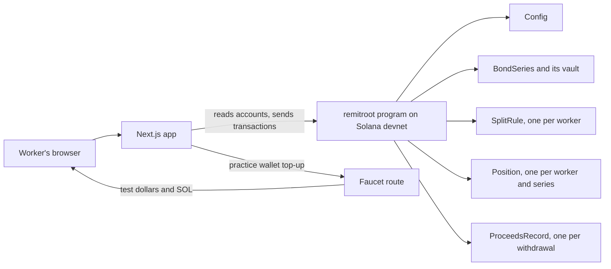

# RemitRoot

*Every transfer splits. Part takes root.*

> **Educational prototype · Solana test network · No real money**

RemitRoot puts saving inside the remittance. A migrant worker sets a rule once. Every transfer after that splits in a single transaction: most goes to the family, and a chosen share (0–50%) buys a savings bond held on-chain.

**Try it:** https://remit-root-mocha.vercel.app. Click "Try the demo"; no wallet or install is needed.

## The problem

Nepal received Rs 2.36 trillion (about $16.19 billion) in remittances in fiscal year 2025/26, more than the national budget for the same year [1]. The Economic Survey put that at around a third of GDP [2]. About one in three households receives remittances, and most of the money goes to consumption and repaying debt [3].

The government already has a tool for turning remittances into investment. Foreign Employment Savings Bonds have been issued by Nepal Rastra Bank since July 2010, only for migrant workers, non-resident Nepalis and recent returnees [4]. They have struggled to sell:

- In 2015, of Rs 250 million offered, Rs 83.71 million was bought, about a third [5].
- In 2015, a central bank official said the 9% yield was offset by about 6% rupee depreciation against the dollar that year [5].
- In 2016, officials cited lack of awareness among workers [4].
- Other reasons given are that the bonds are issued in rupees and the subscription period is short [3].

The gap is that investing is a separate, difficult step, far from the moment the worker handles the money. A Solana Foundation report from September 2026 makes the same point about remittances in general: they come with no attached savings, credit or investment service [6].

## The solution

Put the investment inside the transfer. The worker chooses a savings share once. From then on, saving needs no extra step: it happens every time money is sent home.

RemitRoot does not claim to make transfers cheaper. It changes what a transfer does.

## How it works

1. **Set the split.** The worker picks the family's wallet and a savings share from 0% to 50%.
2. **Send.** One transaction pays the family and moves the savings share into the bond's vault. The worker's bond position grows by that amount.
3. **Watch it grow.** The worker sees total saved, interest so far and the maturity date. Anyone can open the public bond page and see how much was raised, how many savers there are, what the vault holds against what is owed, and each use of funds the issuer has recorded.
4. **Redeem.** After maturity the worker takes back the savings plus simple interest.

On devnet, $200 sent at a 15% share looks like this:

| Step | Result | Transaction |
|---|---|---|
| Send $200 | $170 to the family, $30 into the bond, in one transaction | [explorer](https://explorer.solana.com/tx/2ZDmjsCmynFfhWinmKJnFLhWLiuCgK1wzDwBbzpkHME3bL1CbLWJ6znLqyKBbFC1zHgTueeVe4b8kSdNTHgTNTcg?cluster=devnet) |
| Redeem after maturity | Savings returned to the worker | [explorer](https://explorer.solana.com/tx/5KCoQVoHHo5jgKV8EFuQmQqcuYz22nSXst3aK5wNREsVWRQpAtFYNWQmBVgmRSkN1VfKKDjrU3aSBoNkUmBqZia5?cluster=devnet) |

### Why Solana

- The transfer and the investment settle together in one transaction, so there is no state where the family is paid and the savings are not.
- Fees are small enough that a $30 bond purchase is practical.
- The bond's funds and their use are public, so savers can check where the money went without trusting the operator.

## Architecture



There is no database. The chain is the only source of truth, and the app reads accounts directly. The one server-side piece is the faucet route, which hands a new visitor test dollars and a little devnet SOL.

### Accounts

| Account | Seeds | Holds |
|---|---|---|
| `Config` | `"config"` | Admin, the test-dollar mint, series count |
| `BondSeries` | `"series", id` | Issuer, name, rate, maturity, cap, totals, saver count |
| Vault | `"vault", series` | The series' test dollars, owned by the series |
| `SplitRule` | `"rule", worker` | Recipient, savings share, lifetime totals |
| `Position` | `"position", worker, series` | Principal, accrued interest, last accrual time |
| `ProceedsRecord` | `"proceeds", series, index` | Amount, stated purpose, time |

### Instructions

| Instruction | Signer | What it does |
|---|---|---|
| `initialize` | admin | Creates the config and fixes the test-dollar mint |
| `create_series` | admin | Creates a bond series and its vault |
| `set_split_rule` | worker | Sets the recipient and the savings share |
| `send_remittance` | worker | Splits the transfer between the family and the bond vault |
| `redeem` | worker | After maturity, pays principal plus simple interest |
| `withdraw_proceeds` | issuer | Takes funds from the vault with a public, stated purpose |

### Rules the program enforces

- **Split:** `saved = amount × share / 10,000`, rounded down; `family = amount − saved`. Nothing is lost to rounding.
- **Share limit:** the savings share cannot exceed 50%.
- **Interest:** simple, not compound. It is booked before any change to the principal and stops at maturity.
- **Caps and maturity:** a transfer fails if it would exceed the series cap or the series has matured.
- **Solvency:** a redemption fails with a clear error if the vault cannot cover it. The public page shows the vault balance against what is owed.
- **Access:** only the admin creates series, only the issuer withdraws, and no instruction lets one user move another user's funds.

All arithmetic is checked. Token accounts are verified against the expected mint and owner.

## Run it

Needs Rust, the Solana CLI, Anchor 1.1.x, Node and yarn.

```bash
# Program: build and run the 11 tests (Rust, LiteSVM)
anchor build
anchor test

# Web app
cd app && yarn install && yarn dev    # http://localhost:3000
```

The app talks to devnet out of the box. Demo mode needs a faucet key; setup and environment variables are in [`app/README.md`](app/README.md).

### Devnet scripts

```bash
yarn install
yarn setup:devnet                       # test dollar, config and a 30-day bond series
yarn setup:devnet --maturity-minutes 5  # add a short series for a live redemption
yarn seed                               # sample savers and use-of-funds records
yarn faucet <address> --usd 1000 --sol 0.05
yarn flow --redeem true                 # one full run with explorer links
yarn pay-interest --series 3 --usd 1    # issuer pays interest into a vault so savers can redeem
```

Addresses are written to `idl/devnet.json`. The scripts refuse to run against mainnet.

### Repo layout

```
programs/remitroot/        Anchor program (Rust), one instruction per file
programs/remitroot/tests/  Program tests (Rust, LiteSVM)
idl/                       IDL, TypeScript types and devnet addresses
app/                       Web app (Next.js): landing, send, public bond page
scripts/                   Devnet setup, faucet, seed data, full-flow run
```

## Devnet addresses

| What | Address |
|---|---|
| Program | [`4diHFDJAtmQXPvi7ePbozYJ7De76ChL3cGiBqWwcv2gT`](https://explorer.solana.com/address/4diHFDJAtmQXPvi7ePbozYJ7De76ChL3cGiBqWwcv2gT?cluster=devnet) |
| Test dollar mint (6 decimals, no value) | [`6KXvkDwG51KtsvMGLhWp1R5EYjx3BemGrhqQ1ZuF7Rku`](https://explorer.solana.com/address/6KXvkDwG51KtsvMGLhWp1R5EYjx3BemGrhqQ1ZuF7Rku?cluster=devnet) |
| Config | [`BU1RxTScKPgbVg9JCwD6MU68RbWDb6UjmnJeyhyBu9Vq`](https://explorer.solana.com/address/BU1RxTScKPgbVg9JCwD6MU68RbWDb6UjmnJeyhyBu9Vq?cluster=devnet) |
| Bond series 0, "Savings Bond 2026-A" | [`8smsSjTmYWExnjajvKj4xtxmNVe7UNYZaedbZeFC3LGW`](https://explorer.solana.com/address/8smsSjTmYWExnjajvKj4xtxmNVe7UNYZaedbZeFC3LGW?cluster=devnet) |
| Series 0 vault | [`8TuAHwW5cnu95mnGyn3jEpytiLQwAyitKYbFtGftgcwA`](https://explorer.solana.com/address/8TuAHwW5cnu95mnGyn3jEpytiLQwAyitKYbFtGftgcwA?cluster=devnet) |

The full list, including the short series used for redemption tests, is in [`idl/devnet.json`](idl/devnet.json).

## What the prototype does not do

- **No interest claim before maturity.** Interest is paid with the principal at redemption.
- **No repay instruction.** The issuer funds interest with a plain token transfer into the vault. Until that happens, a redemption is refused.
- **Issuer actions run from scripts.** There is no issuer page, and the family's view is a card on the send page.
- **English only.** All text goes through one translation file, but the Nepali version is not written.
- **No early exit.** A position cannot be sold before maturity.
- **Rupee depreciation is not solved.** The test bond is in test dollars. What currency a real bond uses is a decision for its issuer.

## How a real version would work

A licensed remittance company or the central bank would operate it. Workers would pay in local currency abroad and families would receive rupees as they do today; the blockchain would be the record-keeping and settlement layer behind the scenes.

Nepal Rastra Bank states that virtual currency, including stablecoins, is illegal in Nepal [7]. A real version would need regulatory approval. RemitRoot is offered as a model for regulators and licensed remittance operators to evaluate.

## Disclaimer

This is an educational prototype for a hackathon. It runs only on Solana devnet and local test validators, with a test token that has no value. It is not a financial product, not an offer, and not a promise of any return. It must not be used with real funds.

## Sources

Figures were checked on 9 October 2026. Figures from 2015 and 2016 are old and are labelled with their year.

1. Onlinekhabar, citing Nepal Rastra Bank: [remittances in 2025/26](https://english.onlinekhabar.com/remittances-nepal-2026.html)
2. ShareSansar: [Economic Survey estimate of remittances as a share of GDP](https://www.sharesansar.com/newsdetail/international-day-of-family-remittances-observed-spotlighting-migrant-workers-contribution-to-global-and-nepals-economy-2026-06-17); see also [Rising Nepal](https://risingnepaldaily.com/news/73512)
3. Nepal Economic Forum: [household use of remittances and the savings bonds](https://nepaleconomicforum.org/14261-2/)
4. The Himalayan Times: [Foreign employment savings bonds remain undersubscribed](https://thehimalayantimes.com/business/foreign-employment-savings-bonds-remain-undersubscribed)
5. The Himalayan Times: [Demand for FESBs subdued](https://thehimalayantimes.com/business/demand-for-fesbs-subdued)
6. Solana Foundation: [Stablecoins are reshaping remittances](https://solana.com/news/report-stablecoins-are-reshaping-remittances)
7. B360 Nepal: [Nepal Rastra Bank on virtual currency](https://b360nepal.com/cryptocurrency-networking-businesses-illegal-nrb/)

## Licence

MIT. See [`LICENSE`](LICENSE).
